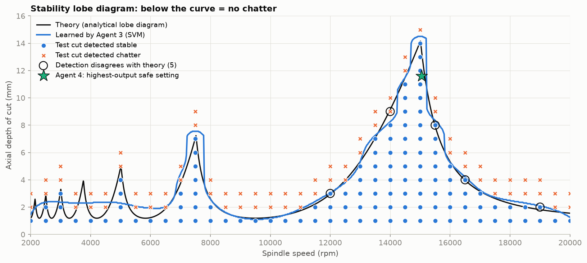
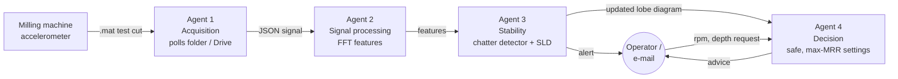
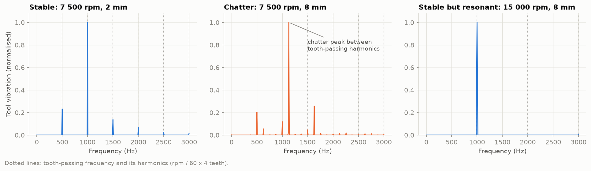
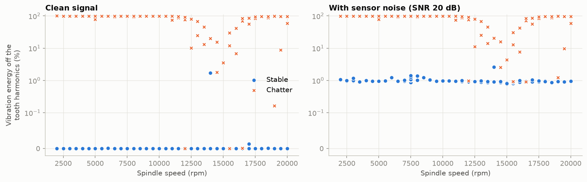
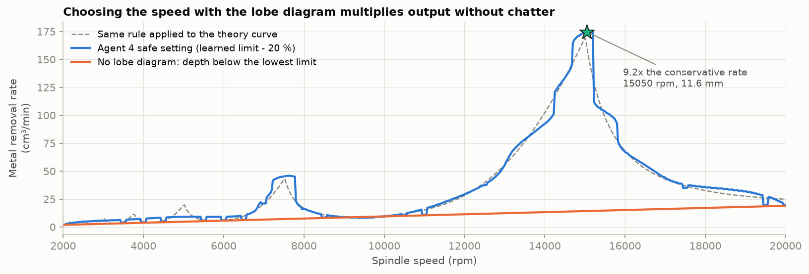
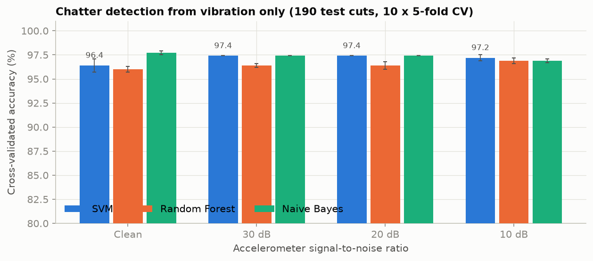

# Milling Chatter Multi-Agent System

**Four cooperating software agents that listen to a milling machine's vibration, recognise chatter, learn the machine's stability lobe diagram and tell the operator which spindle speed and depth of cut give the most output without chatter.**


*Chatter* is the self-excited vibration that leaves a wavy surface, breaks tools and forces machinists to cut timidly. Whether a cut chatters depends on two settings: **spindle speed** and **axial depth of cut**. The boundary between safe and unsafe settings is the **stability lobe diagram (SLD)**. Between its "lobes" there are speeds where the machine can cut several times deeper without chatter. This project finds those speeds automatically from test-cut data.

| What | Result |
|---|---|
| Chatter detected from vibration alone (190 test cuts, unseen recordings, sensor noise 10 to 30 dB) | **97.1 %** accuracy, 95 % of chatter cuts caught (SVM) |
| Stability lobe diagram learned from the agents' own detections vs. theory | **96.9 %** of the speed-depth map correct, limit within **0.43 mm** on average |
| "Best speed" advice that is truly chatter-free (checked against theory) | **100 %** |
| Metal removal rate at the recommended lobe pocket vs. staying below the lowest chatter limit | **9.2x** |

<p align="center"></p>

---

## How it works



| Agent | Job | Code |
|---|---|---|
| 1. Acquisition | Watches a folder (Google Drive in the course demo) and reads each new test cut once | [`agent1_acquisition.py`](chatter_agents/agent1_acquisition.py) |
| 2. Signal processing | FFT of the tool acceleration; measures how much vibration sits **between** the tooth-passing harmonics | [`agent2_signal.py`](chatter_agents/agent2_signal.py) |
| 3. Stability | Classifies each cut stable / chatter (SVM, Random Forest, Naive Bayes compared) and learns the lobe diagram from all cuts so far | [`agent3_stability.py`](chatter_agents/agent3_stability.py) |
| 4. Decision | For any requested speed + depth: predicts chatter, gives the deepest safe cut at that speed, and searches all speeds for the highest metal removal rate | [`agent4_decision.py`](chatter_agents/agent4_decision.py) |
| Coordinator | Routes JSON messages between agents and keeps the shared test history | [`orchestrator.py`](chatter_agents/orchestrator.py) |

All agents are also exposed as a REST API ([`api.py`](chatter_agents/api.py)), which is what the n8n workflow's HTTP nodes call.

### The physics behind the detector

A milling cutter with *z* teeth at *n* rpm hits the work at the **tooth-passing frequency** f<sub>tp</sub> = n/60 &times; z. In a stable cut the vibration is *forced*: all its energy sits on f<sub>tp</sub> and its harmonics. When chatter starts, the tool vibrates near its own natural frequency, which is generally **not** a harmonic. Agent 2 therefore measures:

* `log_peak_ratio`: strongest off-harmonic peak / strongest harmonic peak. Broadband sensor noise is spread over thousands of FFT bins, so this stays low for stable cuts even on a noisy signal.
* `dominant_offset`: where the biggest peak sits between two harmonics (0 = on a harmonic, 0.5 = midway).
* `log_chatter_ratio`: share of total vibration energy off the harmonics.

Speed and depth are **not** given to the detector. It must recognise chatter from the vibration alone.

<p align="center"></p>

The right-hand panel is the trap that fools amplitude-based checks. At 15 000 rpm the tooth-passing frequency (1 000 Hz) lands on the tool's resonance, so the vibration is large but perfectly stable. The frequency content tells the truth.

<p align="center"></p>

### Learning the lobe diagram

Agent 3 fits an RBF-kernel SVM to the (speed, depth) points labelled by the detector. It adds one physical rule: at a fixed speed, a cut deeper than one that chattered also chatters, and a cut shallower than a stable one is also stable. Testing stops once chatter appears, so without this rule the model would guess "stable" in the untested deep region. The limit at each speed is the first depth where P(stable) falls below 0.5.

### Choosing the cut (Agent 4)

Metal removal rate in milling is MRR = a<sub>e</sub> &times; a<sub>p</sub> &times; f<sub>z</sub> &times; z &times; n. With radial width a<sub>e</sub> and feed per tooth f<sub>z</sub> fixed, it is proportional to **speed &times; depth**. Agent 4 keeps a 20 % margin below the learned limit. It never recommends a cut deeper than one already proven stable at that speed, and it scans 2 000 to 20 000 rpm for the speed that maximises MRR.

<p align="center"></p>

---

## Results

All numbers come from `python scripts/evaluate.py` and are stored in [`results/metrics.json`](results/metrics.json).

**Chatter detection** (10 &times; repeated 5-fold cross-validation; noise added to the accelerometer signal):

| Model | Clean | 30 dB | 20 dB | 10 dB |
|---|---|---|---|---|
| SVM | 96.4 % | 97.4 % | 97.4 % | 97.2 % |
| Random Forest | 96.0 % | 96.4 % | 96.4 % | 96.9 % |
| Naive Bayes | 97.7 % | 97.4 % | 97.4 % | 96.9 % |

The deployed detector (SVM) is trained on all noise levels together. Cross-validation is grouped by recording, so the same cut never appears in both training and test, even at another noise level. It scores **97.1 %**, catching **95 %** of chatter cuts.

<p align="center"></p>

**Lobe diagram vs. theory** (speeds 2 000 to 20 000 rpm, depths up to 15 mm):

| Lobe model (trained on detected labels) | Map agreement | Mean limit error | Area wrongly called safe |
|---|---|---|---|
| SVM | 96.9 % | 0.43 mm | 2.5 % |
| Random Forest | 95.7 % | 0.54 mm | 3.4 % |
| Naive Bayes | 84.9 % | 2.25 mm | 9.9 % |
| Baseline: midpoint between tested depths, interpolated | n/a | 0.37 mm | n/a |

The simple non-ML baseline is about as accurate on the limit line, because the test speeds are only 500 rpm apart. The SVM's value is a smooth probability map that Agent 4 can query at any speed, plus a confidence for every answer.

**Agent 4 safety** (all 190 tested conditions submitted as operator requests):

| Safety margin | Same-speed advice truly stable |
|---|---|
| 10% | 97.9 % |
| 15% | 100.0 % |
| 20% | 100.0 % |
| 25% | 100.0 % |

With the default 20 % margin, the best-speed advice was chatter-free in **100 %** of requests. The highest-output safe setting found is **15050 rpm at 11.6 mm** (theory limit 13.4 mm), giving 175 cm³/min against 19 cm³/min when the depth is kept below the lowest chatter limit at any speed (**9.2x**). For requests that would chatter, the best-speed option gives a median **8.5x** the MRR of simply reducing the depth.

---

## Run it

```bash
pip install -r requirements.txt
pytest -q                                  # 11 tests: physics checks, agents, REST API
python scripts/demo_pipeline.py            # 4 agents on the sample recordings, prints alerts + advice
uvicorn chatter_agents.api:app --port 8000 # REST API, docs at http://localhost:8000/docs
```

Example requests:

```bash
curl -F "file=@data/sample_recordings/time3_49.mat" localhost:8000/pipeline/analyse
curl -H "Content-Type: application/json" -d '{"rpm": 9500, "doc_mm": 3}' localhost:8000/agent4/advise
```

**With n8n (as in the course demo):** `docker compose up` starts the agents API (port 8000) and n8n (port 5678). Import [`n8n/workflow_v1_course_demo.json`](n8n/workflow_v1_course_demo.json), add your own Google Drive / Gmail / Gemini credentials, and point the HTTP nodes at `http://agents:8000/agent1/extract`, `/agent2/features`, `/agent3/detect`, `/agent4/advise` (one service replaces the eight per-port services of v1).

**Reproduce everything from the raw dataset:** `python scripts/build_features.py --data-dir "<Dataset 3 mat>"`, then `python scripts/evaluate.py`.

## Repository layout

```
chatter_agents/   the four agents, coordinator and REST API
scripts/          build_features.py, evaluate.py, make_figures.py, demo_pipeline.py
data/             features.csv (Agent 2 output for 190 cuts x 4 noise levels), stability_boundary.csv (theory),
                  sample_recordings/ (6 test cuts)
results/          metrics.json, figures/, models.joblib (deployed detector + lobe model)
n8n/              course-demo workflow (credentials and IDs removed)
legacy/           original course-demo FastAPI services (v1)
tests/            pytest suite, run by GitHub Actions together with a Docker build
```

## Data

190 time-domain simulations of a 4-flute milling cutter: spindle speeds 2 000 to 20 000 rpm in 500 rpm steps, axial depths 1 to 15 mm, and about 0.2 to 1.8 s of tool acceleration, displacement and cutting force each (sampled at 25 kHz). Labels (stable / chatter) come from the analytical stability boundary supplied with the data. The raw set (about 170 MB) was provided in the ME5308 course and is not redistributed. The repository contains the features extracted from it, the boundary curve and six sample recordings.

## Limitations

* The data are simulated, so a real accelerometer adds spindle run-out, other machine modes and cutting noise. The noise study covers part of this, and validating on real cuts is the next step.
* Test speeds 500 rpm apart cannot resolve the narrow lobes below 5 000 rpm. Agent 4 therefore only trusts depths proven at tested speeds.
* MRR in cm³/min uses an assumed radial width (5 mm) and feed (0.05 mm/tooth). The *ratios* between options do not depend on them.

## v1 (course demo) → v2 (this repository)

| | v1, May 2026 | v2 |
|---|---|---|
| Chatter decision | SVM on speed + depth only (it learned the boundary, not chatter) | Detector works from vibration frequency content, robust to noise |
| Lobe diagram | One plot per model from Excel files | Learned from the agents' own detections, scored against theory |
| Decision agent | Max stable depth at the requested speed | Also searches all speeds for lobe pockets, with a safety margin and proven-depth cap |
| Deployment | 8 FastAPI apps on 8 ports, run by hand | One tested REST service, Docker image and CI |

## Credits

Built for **ME5308 Smart Manufacturing, IIT Madras (2026)**.

* **Ameen Iszath S** (lead): agent architecture, FFT feature agent, decision agent and MRR optimisation, inter-agent communication, v2 rebuild and evaluation.
* **Aniket Tekade**: data-acquisition and FFT agents, n8n workflow.

Method background: Schmitz &amp; Smith, *Machining Dynamics*; *Predicting chatter using machine learning and acoustic signals from low-cost microphones*; *Evaluation of automated stability testing in machining through closed-loop control and Bayesian machine learning*.

MIT License.
